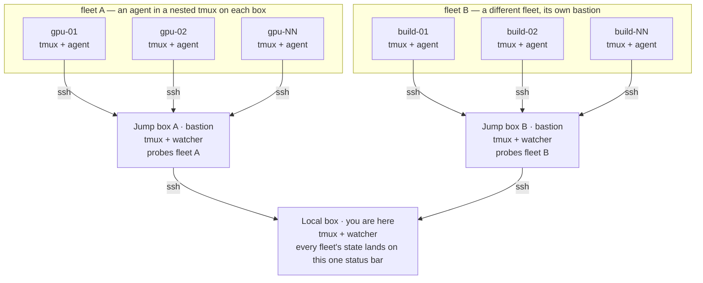

<p align="center">
  
</p>

<h1 align="center">tmux-agent-watch</h1>

<p align="center">
  Live status emoji in your <strong>tmux</strong> window list for AI coding agents — local <em>and</em> over SSH — so you can tell at a glance which agent is working, which is idle, and which is waiting on you.
</p>

| Emoji | State | Meaning |
|:---:|:---|:---|
| 👨‍💻 | `work` | Agent is actively working on a turn |
| 🧑‍🔧 | `ready` | Agent is idle, waiting for your next prompt |
| ✋ | `wait` | Agent needs input — a permission/approval or choice prompt |

When an agent hits ✋ `wait`, its **unfocused tab flashes**.

Supported agents: **Claude Code**, **Hermes**, **Codex**, **Gemini CLI**, **opencode**, **aider**.

## Why

When you run several agents across tmux windows — and some of those windows are SSH sessions into *nested* tmux on remote boxes — there's no easy way to see who needs attention without cycling through every window. `tmux-agent-watch` watches them all from one place and surfaces the state in the status bar.

Look, I'm a shameless tmux junkie, and this is how I actually run shit: a local tmux on my box, SSH'd up into a jump box running its own tmux, fanned out across a whole fleet of machines — each one running, you guessed it, *more* goddamn tmux with an agent nested inside. Tiers on tiers on tiers. And it's not just *one* jump box — I front **different fleets behind different bastions** (GPU boxes behind one, the build farm behind another, prod behind a third), each with its own jump box and its own nested tmux. Every one of those chains rolls all the way back up to the single status bar on my local box. That's not masochism, that's how I babysit a shitload of agents at scale without losing my mind. I tried `herdr` first and it folded the second I nested that deep, so I said fuck it and vibe coded this slop myself. It works across my whole stack, which is the only benchmark I give a shit about. Your mileage may vary.



State rolls **down** each hop — every tab inherits the most-urgent agent above it:
✋ wait &nbsp;>&nbsp; 🧑‍🔧 ready &nbsp;>&nbsp; 👨‍💻 work

## How it works

A single lightweight Python watcher runs per tmux server on your **base host only**. Every couple of seconds it:

- **Local Claude Code** → uses native Claude Code event hooks for exact, event-driven state (installed into `~/.claude/settings.json`).
- **Other local agents** → captures each pane and classifies *current* on-screen UI cues (spinners, "esc to interrupt", input composers, approval prompts). Screen redraws alone are never treated as activity.
- **Remote agents over SSH** → when a pane holds an `ssh` session, the watcher opens a *separate, read-only, non-interactive* SSH connection and inspects the remote tmux — **including hidden/unfocused windows**. Nothing is installed or written on the remote host.
- **Nested local tmux** → attached nested servers are inspected directly, including hidden windows.

Detected state is stored as a tmux window option (`@agentwatch_state`) and rendered in `window-status-format`. Works with both standard tmux and [oh-my-tmux](https://github.com/gpakosz/.tmux).

### oh-my-tmux integration

[oh-my-tmux](https://github.com/gpakosz/.tmux) is what I run, and agent-watch is built to play nice with it. The two don't fight over your status bar — oh-my-tmux owns the look, and agent-watch just appends the state emoji to whatever window-status format you've already got.

The installer **detects oh-my-tmux automatically** (by the `gpakosz` symlink target, or an "oh my tmux" marker in your config) and adapts how it writes itself in:

- **On oh-my-tmux**, it edits your **`.tmux.conf.local`** — never the symlinked `.tmux.conf` that oh-my-tmux ships — and writes its format as shell-style `tmux_conf_theme_window_status_format=...` assignments that *wrap* your existing value, so your theme, separators, and colours survive untouched. The block is tucked in above oh-my-tmux's `# EOF` marker (everything after it is reserved for shell functions).
- **On standard tmux**, it writes plain `set -g window-status-format ...` lines instead.

Both layouts are found: the classic `~/.tmux.conf[.local]` and the XDG `~/.config/tmux/tmux.conf[.local]`. The injected block is fenced with `# >>> tmux-agent-watch base-only >>>` markers, so `--uninstall` lifts it back out cleanly and a timestamped `.bak` of your config is saved on every change.

Want a known-good starting point? [`examples/tmux.conf.local`](examples/tmux.conf.local) is a trimmed version of my own oh-my-tmux local config — prefix remap, sane history/mouse/vi defaults, pane-wrangling binds — with a note marking where agent-watch slots its block in.

### Most-urgent roll-up

A tab that contains several agents (multiple panes, or an SSH session into a remote with many agent windows) shows the **most urgent** state beneath it: **✋ `wait` > 🧑‍🔧 `ready` > 👨‍💻 `work`**. So a box where one agent needs you and three are busy shows ✋ — you never miss the one that's waiting.

### Deep nesting (jump boxes)

The watcher's read-only probe reaches **one SSH hop**. If you chain through a jump box (`local → jump → fleet`), a probe can't type the interactive password your jump box asked for, so run `tmux-agent-watch` **on the jump box too**. Each tier watches the hop below it and publishes state into its own tmux; walking up the chain, every tier rolls up the most-urgent agent beneath it.

Run **more than one fleet behind its own bastion** and the shape is the same, just wider: a watcher on each jump box, each probing its own fleet, and the local box watching every jump box in parallel. Nothing special to configure — each chain is independent, and the local status bar rolls up the most-urgent agent across *all* of them.

The probe is **non-interactive** (`BatchMode`), so each tier needs a key the next hop accepts without a passphrase or prompt. The watcher looks for a dedicated key at **`~/.ssh/agentwatch`** and offers it automatically (in addition to your agent/default keys, so nothing else is affected). To wire up a hop:

```bash
# on the tier that runs the watcher (e.g. the jump box):
ssh-keygen -t ed25519 -N "" -f ~/.ssh/agentwatch -C "agentwatch@$(hostname)"
ssh-copy-id -i ~/.ssh/agentwatch.pub user@next-hop
```

No `ssh_config` entry needed — drop that key on each tier and probes just work.

### Prefix keys per tier

When you nest tmux inside tmux inside tmux, every tier is fighting for the same prefix keystroke — hit it once and the *outermost* tmux swallows it, and you're sending prefixes up the chain just to reach the box you're actually looking at. The fix is to give each tier its **own** prefix so a single keystroke lands exactly where you mean it. This is what I run:

| Tier | Prefix | Why |
|:---|:---:|:---|
| Local workstation | `Ctrl-A` | Keep your existing muscle memory |
| Jump box | `Ctrl-Q` | My preferred replacement for `Ctrl-X` |
| Fleet machines | `Ctrl-B` | Standard tmux prefix; no additional remapping necessary |

The watcher doesn't care what your prefixes are — this is purely for your own sanity driving the stack. Set each tier's prefix in that tier's `~/.tmux.conf`, e.g. on the jump box:

```bash
set -g prefix C-q
unbind C-b
bind C-q send-prefix
```

### Propagation speed across tiers

Remote state is **polled**, not pushed. Each tier re-probes the hop below it every `REMOTE_INTERVAL` (default **8s**), so a state that crosses two hops can lag ~8s per hop — and a burst shorter than the interval (e.g. a 2-second command) can finish *between* probes and never be sampled up the chain. Long-lived states like `wait` (which blocks on you) always propagate; brief `work` bursts may not. Directly-attached panes don't have this lag — they're classified locally every 2s.

To make an outer tier (e.g. a jump box) more responsive, lower its probe interval — live-tunable, no restart:

```bash
tmux set -g @agentwatch_remote_interval 3   # seconds; applies to this tier's watcher
```

Run the hop-heavy tiers hot and leave the fleet-facing tiers at the default to avoid a storm of SSH probes.

## Requirements

- Python 3, `tmux`, and `ssh` on the base host (nothing required on remote hosts).
- For remote detection: **non-interactive key auth** to the remote (the probe can't type a password — see Troubleshooting).

## Install

Install **only on the outer/base tmux host**:

```bash
git clone https://github.com/TheSlopFather/tmux-agent-watch.git
cd tmux-agent-watch
python3 tmux-agent-watch.py
```

This copies itself to `~/.local/bin/tmux-agent-watch`, adds the status-bar format to your tmux config, installs the local Claude Code hooks, reloads tmux, and starts the watcher. Restart any running Claude Code sessions to load the hooks.

Uninstall (restores your tmux config and removes the hooks):

```bash
python3 tmux-agent-watch.py --uninstall
```

### Starting from scratch? oh-my-tmux + agent-watch in one go

Don't have a tmux config yet? This is the fast path I'd actually recommend — [oh-my-tmux](https://github.com/gpakosz/.tmux) gives you a sane status bar to hang the emoji off of, and agent-watch slots right into it. One paste sets up both:

```bash
git clone https://github.com/gpakosz/.tmux.git ~/.tmux \
  && ln -sf ~/.tmux/.tmux.conf ~/.tmux.conf \
  && cp ~/.tmux/.tmux.conf.local ~/ \
  && git clone https://github.com/TheSlopFather/tmux-agent-watch.git ~/.tmux-agent-watch \
  && python3 ~/.tmux-agent-watch/tmux-agent-watch.py
```

That installs oh-my-tmux the standard way (`~/.tmux.conf` symlink + an editable `~/.tmux.conf.local`), then runs the agent-watch installer, which **auto-detects oh-my-tmux** and injects its block into `~/.tmux.conf.local` — your `.tmux.conf` symlink is never touched. Run it on the base host first, then on each jump box (see [Deep nesting](#deep-nesting-jump-boxes)).

### Push a tier onto a remote over SSH

Standing up a jump box (or any middle tier) means two things on that box: the watcher installed, and the tier **above** it authorized to probe it non-interactively. This one paste does both from your current box — it copies **your local copy of the script** (so whatever you're running here is what lands there, no GitHub round-trip) and installs it:

```bash
REMOTE=user@jump-box; ssh-copy-id -i ~/.ssh/agentwatch.pub "$REMOTE" && scp tmux-agent-watch.py "$REMOTE":/tmp/taw.py && ssh "$REMOTE" 'python3 /tmp/taw.py && rm -f /tmp/taw.py'
```

What each step does:

1. **`ssh-copy-id -i ~/.ssh/agentwatch.pub`** — authorizes *this* box's dedicated probe key on the remote, so your watcher's non-interactive (`BatchMode`) SSH probe can log in. This is the hop that actually makes the remote's state roll up to you.
2. **`scp tmux-agent-watch.py`** — pushes your working copy to the remote.
3. **`python3 /tmp/taw.py`** — runs the installer there: it copies itself to `~/.local/bin`, wires the status format into the remote's tmux config (standard *or* oh-my-tmux), installs the local Claude hooks, and starts the watcher. Run against a box with no tmux attached yet, it just defers: *"Watcher will start automatically when you start tmux."*

Prerequisites and notes:

- **This box needs `~/.ssh/agentwatch`** first — generate it with the `ssh-keygen` from [Deep nesting](#deep-nesting-jump-boxes) if you haven't. `ssh-copy-id` will prompt for the remote's password once; that's the only interactive step.
- **The remote needs `python3` and `tmux`** on `PATH` (nothing else). It does *not* need to reach GitHub — the script is pushed directly.
- **If that remote is itself a jump box** over a further hop, repeat the same wiring *from the remote* down to its fleet: SSH in, generate its own `~/.ssh/agentwatch`, and `ssh-copy-id` it to the next hop. Each tier probes only the hop directly below it.
- **Bare box with no tmux config?** Swap in the [from-scratch oneliner](#starting-from-scratch-oh-my-tmux--agent-watch-in-one-go) wrapped in `ssh "$REMOTE" '...'` to lay down oh-my-tmux too.

Verify from your box with `tmux-agent-watch check` — it prints each resolved SSH target and why each state was decided, so a `Permission denied` means step 1 didn't take.

## Usage

Once installed the watcher runs automatically whenever tmux is running; the emoji appear next to window names. Other commands:

```bash
tmux-agent-watch check                 # diagnostics: what each pane/remote resolves to
tmux-agent-watch link %5 gpu-box       # pin outer pane %5 to an SSH host (for undiscoverable nesting)
tmux-agent-watch link %5 gpu-box mysession /tmp/tmux-1000/custom   # optional session + socket
tmux-agent-watch unlink %5             # remove a pin
tmux-agent-watch links                 # list pins
tmux-agent-watch reset                 # clear local native agent states
```

`check` is the place to start when something isn't showing: it prints the discovered SSH targets, remote sockets, per-window states, and the reason for each decision.

## Troubleshooting

**A remote agent's emoji disappears when its window isn't focused.**
The active remote window is visible in your outer SSH pane and classified locally, but *hidden* remote windows require the SSH probe. If the probe can't log in, hidden windows show nothing. Run `tmux-agent-watch check` and look for the remote host.

**`Permission denied (publickey,password)` in `check`.**
Your interactive session logged in with a password; the watcher's separate non-interactive connection can't reuse it. Give the remote a key your SSH agent offers:

```bash
ssh-copy-id your-remote-host
```

**`no accessible tmux server sockets for remote user`.**
The remote tmux is on a non-default socket or a different user. Check `TMUX_TMPDIR` / a custom `-S` socket, or pin it with `tmux-agent-watch link %PANE HOST SESSION SOCKET`.

**A remote emoji briefly flickers off and back.**
A single dropped or slow SSH poll used to blank a hidden-window agent's state until the next poll. The watcher now serves the last good remote result for a short grace period, so a transient probe failure no longer causes a flicker; a genuinely unreachable host still clears after the grace expires.

**Old remote tmux (< 3.6).**
Handled — the remote probe avoids raw control bytes in tmux formats, which older tmux (e.g. 3.5a) octal-escapes.

## Privacy & safety

- Installs and modifies files **only on the base host**; remote hosts are read-only and never written to.
- Remote inspection is streamed over your existing SSH access; no agent/daemon is deployed remotely.
- Remote terminal contents and credentials are never logged.

## License

MIT — © 2026 Kaiju Security. See [LICENSE](LICENSE).
