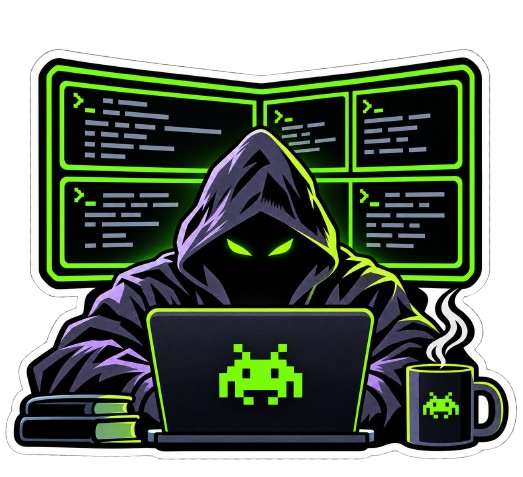

<p align="center">
  
</p>

<h1 align="center">tmux-agent-watch</h1>

<p align="center">
  Live status emoji in your <strong>tmux</strong> window list for AI coding agents — local <em>and</em> over SSH — so you can tell at a glance which agent is working, which is idle, and which is waiting on you.
</p>

| Emoji | State | Meaning |
|:---:|:---|:---|
| 👨‍💻 | `work` | Agent is actively working on a turn |
| 🧑‍🔧 | `ready` | Agent is idle, waiting for your next prompt |
| ✋ | `wait` | Agent needs input — a permission/approval or choice prompt |

Supported agents: **Claude Code**, **Hermes**, **Codex**, **Gemini CLI**, **opencode**, **aider**.

## Why

When you run several agents across tmux windows — and some of those windows are SSH sessions into *nested* tmux on remote boxes — there's no easy way to see who needs attention without cycling through every window. `tmux-agent-watch` watches them all from one place and surfaces the state in the status bar.

I tried `herdr` first, but it didn't fit my workflow with nested tmux sessions, so we vibe coded this slop instead. It works for me; your mileage may vary.

## How it works

A single lightweight Python watcher runs per tmux server on your **base host only**. Every couple of seconds it:

- **Local Claude Code** → uses native Claude Code event hooks for exact, event-driven state (installed into `~/.claude/settings.json`).
- **Other local agents** → captures each pane and classifies *current* on-screen UI cues (spinners, "esc to interrupt", input composers, approval prompts). Screen redraws alone are never treated as activity.
- **Remote agents over SSH** → when a pane holds an `ssh` session, the watcher opens a *separate, read-only, non-interactive* SSH connection and inspects the remote tmux — **including hidden/unfocused windows**. Nothing is installed or written on the remote host.
- **Nested local tmux** → attached nested servers are inspected directly, including hidden windows.

Detected state is stored as a tmux window option (`@agentwatch_state`) and rendered in `window-status-format`. Works with both standard tmux and [oh-my-tmux](https://github.com/gpakosz/.tmux).

## Requirements

- Python 3, `tmux`, and `ssh` on the base host (nothing required on remote hosts).
- For remote detection: **non-interactive key auth** to the remote (the probe can't type a password — see Troubleshooting).

## Install

Install **only on the outer/base tmux host**:

```bash
git clone https://github.com/TheSlopFather/tmux-agent-watch.git
cd tmux-agent-watch
python3 tmux-agent-watch.py
```

This copies itself to `~/.local/bin/tmux-agent-watch`, adds the status-bar format to your tmux config, installs the local Claude Code hooks, reloads tmux, and starts the watcher. Restart any running Claude Code sessions to load the hooks.

Uninstall (restores your tmux config and removes the hooks):

```bash
python3 tmux-agent-watch.py --uninstall
```

## Usage

Once installed the watcher runs automatically whenever tmux is running; the emoji appear next to window names. Other commands:

```bash
tmux-agent-watch check                 # diagnostics: what each pane/remote resolves to
tmux-agent-watch link %5 gpu-box       # pin outer pane %5 to an SSH host (for undiscoverable nesting)
tmux-agent-watch link %5 gpu-box mysession /tmp/tmux-1000/custom   # optional session + socket
tmux-agent-watch unlink %5             # remove a pin
tmux-agent-watch links                 # list pins
tmux-agent-watch reset                 # clear local native agent states
```

`check` is the place to start when something isn't showing: it prints the discovered SSH targets, remote sockets, per-window states, and the reason for each decision.

## Troubleshooting

**A remote agent's emoji disappears when its window isn't focused.**
The active remote window is visible in your outer SSH pane and classified locally, but *hidden* remote windows require the SSH probe. If the probe can't log in, hidden windows show nothing. Run `tmux-agent-watch check` and look for the remote host.

**`Permission denied (publickey,password)` in `check`.**
Your interactive session logged in with a password; the watcher's separate non-interactive connection can't reuse it. Give the remote a key your SSH agent offers:

```bash
ssh-copy-id your-remote-host
```

**`no accessible tmux server sockets for remote user`.**
The remote tmux is on a non-default socket or a different user. Check `TMUX_TMPDIR` / a custom `-S` socket, or pin it with `tmux-agent-watch link %PANE HOST SESSION SOCKET`.

**A remote emoji briefly flickers off and back.**
A single dropped or slow SSH poll used to blank a hidden-window agent's state until the next poll. The watcher now serves the last good remote result for a short grace period, so a transient probe failure no longer causes a flicker; a genuinely unreachable host still clears after the grace expires.

**Old remote tmux (< 3.6).**
Handled — the remote probe avoids raw control bytes in tmux formats, which older tmux (e.g. 3.5a) octal-escapes.

## Privacy & safety

- Installs and modifies files **only on the base host**; remote hosts are read-only and never written to.
- Remote inspection is streamed over your existing SSH access; no agent/daemon is deployed remotely.
- Remote terminal contents and credentials are never logged.

## License

MIT — © 2026 Kaiju Security. See [LICENSE](LICENSE).
